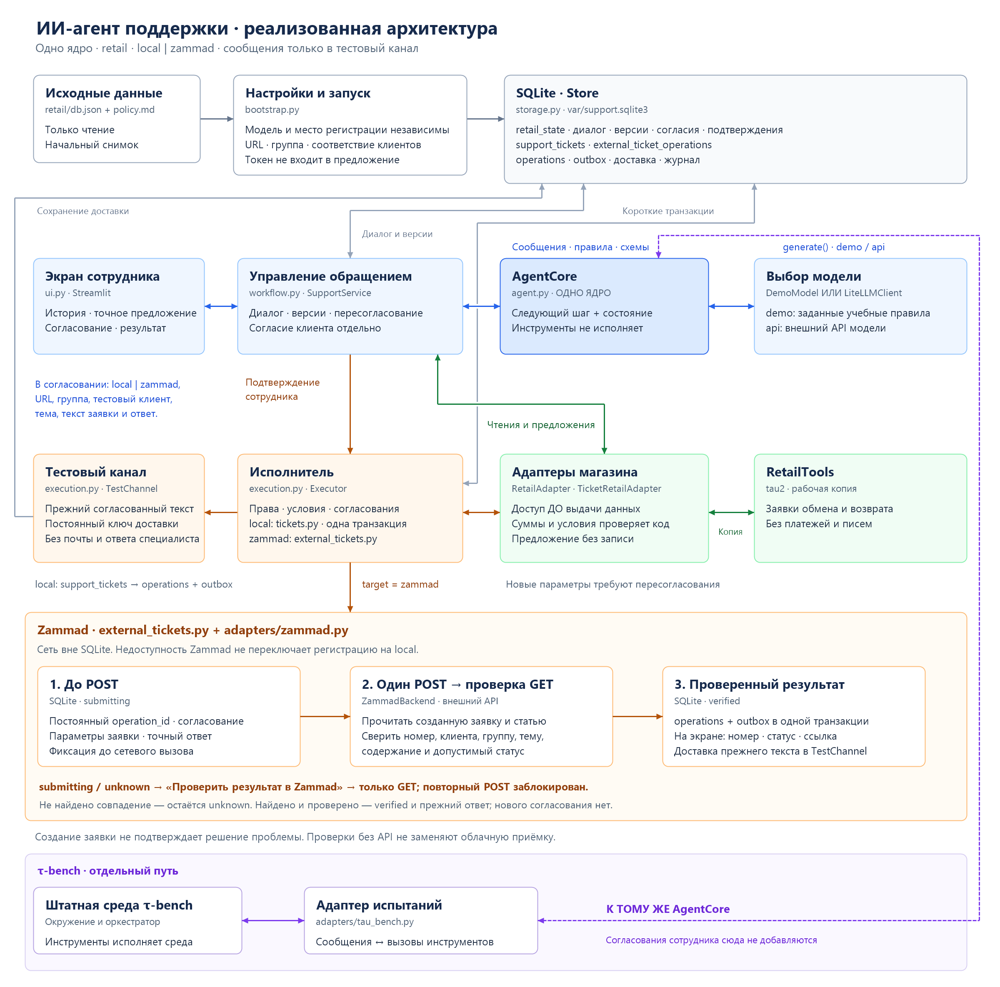

# Архитектура ИИ-агента поддержки

Реализовано локальное приложение на Python: экран сотрудника, общее ядро расследования, версии предложений, пересогласование изменившихся условий, исполнитель, SQLite и тестовая доставка. Оно поддерживает обмен и возврат на рабочей копии магазина `retail` из τ-bench. По умолчанию используется учебная заглушка; модель через API включается явно.

Схема показывает реализованные компоненты. Источником служит испытательный магазин, а получателем сообщений — локальный тестовый канал. Реальные CRM, платежи, внешняя доставка и авторизация сотрудников не подключены.



[Открыть схему PNG](architecture.png)

Схему PNG создаёт [скрипт](../scripts/render_architecture.ps1): `powershell -NoProfile -ExecutionPolicy Bypass -File scripts/render_architecture.ps1` из корня проекта.

## Компоненты

| Компонент | Реализация и ответственность |
|---|---|
| Экран сотрудника | `ui.py`: история, основания, параметры, разница условий, точный ответ, подтверждение или отклонение, фактический результат |
| Управление обращением | `workflow.py`: вызовы ядра, инструменты чтения, общая подготовка предложений, ручное/автоматическое продолжение и ответ клиента |
| Ядро агента | `agent.py`, `models.py`: следующий шаг через модель, собственные сообщения и состояние, проверка имени и схемы инструмента |
| Предложения | `proposals.py`: версия, действие, значения существенных условий, результат проверки, основания и точный согласуемый текст |
| Исполнитель | `execution.py`: проверка обращения, актуальности условий, согласий и повтора; атомарная операция и проверка результата |
| Источник данных | `adapters/retail.py`: чтение сведений, расчёт суммы, подготовка и исполнение обмена или возврата на рабочем снимке |
| Тестовый канал | `TestChannel` в `execution.py`: сохранение утверждённого сообщения с постоянным идентификатором доставки; внешней отправки нет |
| Хранилище | `storage.py`: рабочий магазин, обращения, версии, согласия, продолжения `recoveries`, операции, доставка и журнал в SQLite |
| Настройки и модели | `bootstrap.py`, `adapters/demo_model.py`, `adapters/llm.py`: инициализация базы, учебная заглушка либо LiteLLM |
| Адаптер τ-bench | `adapters/tau_bench.py`: преобразование сообщений и вызовов между ядром и штатной испытательной средой |

Модель предлагает следующий шаг. Разрешение на запись и отправку проверяет приложение. Логика ядра не зависит от Streamlit, SQLite и внутренних типов τ-bench; состояние передаётся явно, а в приложении сохраняется вместе с обращением.

Каждый инструмент чтения проверяет доступ **до возврата данных ядру**. Клиента и сотрудника закрепляет приложение в обращении; аргументы модели не расширяют этот контекст. Сообщения клиента и текст источников не могут выдать права, добавить инструменты или создать согласование. Это ограничения кода, а не только указания модели. Сейчас чтение товаров ограничено каталогом товаров из заказов выбранного клиента.

## Предложение и согласование

Предложение содержит идентификатор, версию, действие с параметрами либо только сообщение, сумму, основания и точный текст ответа. Технические отпечатки на экран не выводятся.

| Что проверяется | Сохранённые условия |
|---|---|
| Операция | Клиент и заказ, позиции и замены с количеством, способ оплаты, разница в сумме в USD, ожидаемый статус заявки |
| Допустимость | Текущий заказ, способы оплаты клиента, выбранные товары и правила; суммы и ограничения пересчитывает адаптер |
| Согласие клиента | Идентификатор доставленного вопроса, его условия, ответ и признак отзыва согласия |
| Подтверждение сотрудника | Сотрудник, обращение, версия и полное содержимое предложения, включая точный текст; получатель закреплён в обращении |

Отпечаток не включает весь магазин: изменение постороннего заказа не блокирует действие. Он пока консервативен внутри выбранных сущностей: изменение другого варианта того же товара или способа оплаты клиента тоже может потребовать нового согласования.

`Action.condition_values` хранит прежние значения рядом с отпечатком `conditions`. `RetailAdapter.check` пересчитывает условия и возвращает `unchanged`, `changed` или `forbidden`, причину и различия «было / стало». Сумму и допустимость определяет код. Старые сериализованные действия без `condition_values` читаются, но ожидающая исполнения карточка не проходит проверку: нужно новое предложение. Уже сохранённые операции и очередь доставки продолжаются по прежним ключам, без повторного исполнения.

Одна карточка поддерживает два режима:

- **«Только сообщение»** — уточнение, запрос согласия клиента, отказ или объяснение ошибки. Сотрудник подтверждает отправку; заказ не меняется.
- **«Действие и ответ»** — операция с полными параметрами. Исполнитель проверяет согласования и текущие данные, выполняет действие и передаёт утверждённый текст в тестовый канал.

Согласие клиента и подтверждение сотрудника — отдельные события. Запрос согласия сначала должен быть согласован сотрудником и доставлен. Затем оператор вводит имитируемый ответ клиента и выбирает «Клиент согласен» либо «Клиент отказался». Это явный учебный ввод, а не автоматическая проверка свободного текста и не настоящий канал связи с клиентом.

Согласие клиента относится к конкретному действию и его текущим условиям. Новый запрос клиента, отказ или изменившиеся данные не позволяют исполнить прежнее согласование. После согласия клиента новое предложение действия отдельно подтверждает сотрудник.

Правка только текста требует нового подтверждения сотрудником, но сама по себе не меняет согласованные клиентом условия операции. Выполненное действие не повторяется при подготовке следующего сообщения. Прямое редактирование карточки в интерфейсе не предусмотрено: сотрудник отклоняет её с причиной и получает новый проект.

## Прохождение обращения

1. Сотрудник выбирает клиента и создаёт обращение. Интерфейс использует локальный идентификатор `demo-employee`; проверки принадлежности обращения этому идентификатору есть, реальной аутентификации нет.
2. Ядро проверяет клиента инструментом поиска по email либо имени и индексу. До подтверждения найденного идентификатора чтение остальных данных блокируется; сведения другого клиента не выдаются.
3. Приложение выполняет разрешённые чтения. Инструменты `propose_exchange` и `propose_return` рассчитывают и готовят предложение, не меняя магазин.
4. Сотрудник изучает основания, параметры, сумму и текст. Отклонение с причиной запускает пересмотр; новый проект остаётся неотправленным до подтверждения.
5. Для записи нужны доставленный запрос условий, согласие клиента и отдельное подтверждение сотрудником актуального предложения. Исполнитель повторно проверяет условия, допустимость операции и принадлежность данных.
6. После успешной операции сохраняются фактический результат и согласованный текст. Тестовый канал фиксирует его доставку; текст не перегенерируется.

При изменившихся условиях прежнее предложение становится недействительным. При ошибке операции изменения откатываются, а сообщение об ошибке готовится как новое предложение для сотрудника. Повторное подтверждение возвращает сохранённый результат операции. Повтор доставки использует прежнее согласование и текст.

В `retail` обмен создаёт `exchange requested`, возврат — `return requested`. Эти статусы обозначают заявки. Платежи, фактическая передача товара и отправка письма не выполняются.

## Пересогласование изменившихся условий

Режим задаётся при запуске через `SUPPORT_AGENT_RECOVERY_MODE`: `manual` по умолчанию, `auto` — автоматическая подготовка новой версии. Оба используют одинаковые ядро, инструменты, исполнитель и правила согласования. При блокировке старой версии ручной режим ждёт кнопки «Продолжить расследование»; автоматический показывает разницу и запускает тот же `resume`. Подготовленный вопрос или ответ остаётся на согласовании сотрудника.

Исполнитель помечает предложение `stale`, отзывает прежнее согласие и сохраняет результат проверки в `recoveries`. Ключ — идентификатор исходного предложения; состояния — `pending`, `running`, `prepared`, `failed`, `cancelled`. Транзакция разрешает один запуск подготовки на событие. Повтор после завершения возвращает сохранённую версию. Вызов модели идёт вне транзакции; ревизия обращения не позволяет запоздавшему ответу заменить более новое решение.

Результат проверки поступает ядру через `continue_with_event` как служебное сообщение `assistant`, а не реплика клиента. Ручной запуск отдельно отмечается событием `manual_resume`, автоматический — `automatic_resume`. Согласия приложение создаёт только при явных действиях оператора.

Повторная смена цены проверяется и перед отправкой вопроса, и при ответе на уже доставленные условия. Устаревшее «да» сохраняется как `consent_outdated` и запускает новый цикл в выбранном режиме. Отказ принимается без проверки прежней суммы, отзывает согласие и отменяет продолжение. Новое сообщение клиента и отклонение сотрудником также отменяют незавершённое продолжение; обычный пересмотр создаёт новое несогласованное предложение. Ошибка подготовки не запускает автоматические повторы.

## Данные и исполнение

При первой инициализации в отдельную таблицу `retail_state` копируются исходный магазин и правила. Обращения, предложения, согласия, продолжения, операции, журнал и доставка хранятся отдельно от `RetailDB`. Исходные файлы τ-bench остаются неизменными; повторный запуск использует существующую SQLite и не перечитывает источник для обновления рабочего снимка.

Локальное действие выполняется в одной транзакции `BEGIN IMMEDIATE`: прочитать актуальный снимок и согласования, проверить условия, вызвать `RetailTools` на отдельной копии, проверить результат, сохранить снимок и запись операции, учесть использованное согласие и подготовить согласованный текст к отправке. Адаптер не открывает независимую запись. При ошибке изменения откатываются до точки сохранения; копия отбрасывается, а причина ошибки и новый проект ответа сохраняются до освобождения блокировки.

Идентификатор предложения служит постоянным ключом операции; уникальность обеспечена ключом таблицы `operations`. Очередь содержит собственный постоянный идентификатор сообщения, точный текст и ссылки на предложение и обращение. По этим ссылкам определяются согласование, результат операции и получатель; канал в этой версии всегда локальный `TestChannel`. Получатель также исключает повтор по идентификатору. Другие параметры с прежним идентификатором отклоняются.

Соединение ждёт освобождения SQLite до 10 секунд. Если запись остаётся занятой, запрос завершается ошибкой; автоматического повтора нет. Повтор команды начинает чтение и проверки заново, а не сохраняет ранее рассчитанный снимок.

Вызовов модели и внешних API внутри этой транзакции нет. Доставка выполняется после фиксации результата, с постоянным идентификатором. Её состояние хранится отдельно, поэтому ошибка отправки не запускает обмен или возврат повторно. Версия обращения также защищает сохранённое состояние от запоздавшего ответа расследования.

По умолчанию рабочая база — `var/support.sqlite3`; путь задаётся через `SUPPORT_AGENT_DB`. `SUPPORT_AGENT_RETAIL_DB` меняет исходный `db.json`, рядом с которым должен лежать `policy.md`. Для нового снимка используют новое имя SQLite, сохраняя старую историю. Настройки вступают в силу после перезапуска приложения.

Для будущей внешней системы общей транзакции с SQLite не будет. Её адаптер должен отдельно учитывать гарантии исполнения и ключи повторного запроса. Тайм-аут означает неизвестный результат: до повторной записи или сообщения об успехе потребуется проверить состояние операции. Этот внешний путь сейчас не реализован.

## Продолжение после остановки

SQLite хранит сериализованный `AgentState` с сообщениями и результатами инструментов, версии предложений, согласия, результат операции, очередь и состояние доставки. Ожидаемый следующий шаг определяется этими записями; `st.session_state` хранит только состояние экрана и экземпляр службы. Входящие события создаются приложением с идентификатором обращения и типом автора; журнал назначает им собственные идентификаторы. Внешний приём сообщений пока не подключён.

| Состояние | Как продолжить |
|---|---|
| Вопрос клиенту доставлен, ответа нет | Ждать отдельного события согласия или отказа; не выполнять действие |
| Клиент отказался или изменил запрос | Старое согласие не действует, нужна новая подготовка предложения |
| Сотрудник отклонил карточку | Причина сохраняется, старая версия закрывается; новый проект снова ожидает подтверждения |
| Условия изменились | Старое решение блокируется; `manual` ждёт команды сотрудника, `auto` готовит новую версию. Новые согласования обязательны |
| Операция зафиксирована, ответ ещё в очереди | Кнопка «Продолжить отправку» доставляет прежний текст; нового согласования и операции нет |
| Доставка не подтверждена | «Повторить отправку» использует прежний идентификатор и текст |
| Экран обновлён | Восстановить сохранённое обращение; само обновление ничего не исполняет |
| Процесс остановлен во время запроса модели | Входящее событие сохранено; фонового возобновления нет. Новое сообщение клиента отменяет `running` и запускает обычную подготовку |

Фонового отправителя нет: после перезапуска продолжение доставки запускает сотрудник. Это продолжение уже согласованного сообщения; его нельзя смешивать с повторным согласованием изменённых условий. Замена текста после ошибки операции требует новой карточки и подтверждения.

## Режимы модели и испытаний

`SUPPORT_AGENT_MODE=demo` используется по умолчанию и не читает файл с ключами. Учебная модель ищет доставленный заказ среди первых шести заказов клиента и работает по заданным правилам: одна позиция и первый другой доступный вариант. Она не разбирает произвольные предпочтения; описание ограничений показано на экране. Это проверка общего процесса, а не оценка качества языковой модели.

При явно установленном `SUPPORT_AGENT_MODE=api` настройки берутся из окружения либо `.env` корня приложения. Подготовка и пересмотр предложения могут вызвать настроенную модель. Создание сервиса само API не вызывает. Учебный режим, исполнитель и UI проверяются без оплачиваемых запросов.

У общего ядра два пути исполнения инструментов:

- **Приложение:** русские указания рабочего процесса, инструменты подготовки предложений, сотрудник, проверка согласий и исполнитель.
- **Штатный τ-bench:** `HalfDuplexAgent` с исходными английскими правилами, исходными инструментами и имитатором клиента. Инструменты выполняет среда; согласование сотрудником в задания не добавляется.

Адаптер τ-bench реализует `get_init_state` и `generate_next_message`. Ядро не получает скрытые инструкции имитатора и `evaluation_criteria`. Каждая попытка начинается со свежей среды. Исходные задания и проверки приложения учитываются отдельно; успешный учебный процесс не доказывает улучшение относительно базового агента.

Для пересогласования реализован отдельный скрипт `evals/reapproval/run_reapproval.py`. Он сравнивает режимы на собственных синтетических случаях: прежние условия, новая цена и запрещающий статус. Для пары копируется вся SQLite после согласия клиента, перед окончательным подтверждением сотрудника. Клиент и сотрудник действуют по фиксированному сценарию. Это проверка процесса, а не измерение удобства UI или штатная оценка τ-bench.

`--offline` проверяет процесс с заглушкой и не считается пилотом. Оплачиваемые этапы — 6 пилотных и, при обоснованном продолжении, 18 основных попыток с одной моделью `openai/responses/gpt-6-luna`. Основной запуск требует технически готового оплачиваемого пилота и неизменных хешей исходников, данных и настроек. Первый пилот дал 5/6 из-за ошибки текстовой проверки; после её исправления и отдельного разрешения повторный пилот дал 6/6. Основной прогон завершён с результатом 17/18: ещё одна формулировка корректного отказа не распознана стендом. Исходные результаты сохранены. Ручное продолжение остаётся режимом по умолчанию, автоматическое — экспериментальным; результаты и ограничения вывода — в [отчёте о пересогласовании](evaluation/reapproval.md).

Один вызов расследования ограничен 12 шагами ядра. Скрипт сравнения дополнительно ограничивает всю попытку 60 шагами и 600 секундами, включая повторную подготовку; шаг — вызов модели, её инструмент или действие сотрудника. API-настройки сравнения: `reasoning_effort=low`, `max_tokens=8192`, тайм-аут до 90 секунд, повторов нет. Общий `budget.json` сохраняет резерв до вызова и учитывает подготовку и оба этапа в пределах согласованных 5 USD. Неизвестный расход сохраняется как полный резерв. Эти пределы относятся к испытанию; рабочее место сохраняет свой один технический повтор API.

В `manifest.json` и каталогах попыток сохраняются контрольные точки, сообщения, события, результаты, расходы и хеши. Дополнительные вмешательства — `manual_resume` и `rejected`; обязательные подтверждения и доставка учитываются отдельно. Парная разница считается только при правильном результате обоих режимов, неуспешные пары показываются отдельно. Команды и ограничения — в [описании сравнения](../evals/reapproval/README.md).

## Стек и структура

Python 3.12, Pydantic для контрактов, JSON Schema для аргументов, LiteLLM для модели, Streamlit для экрана, SQLite для рабочего состояния, pytest и AppTest для проверок.

```text
src/support_agent/
├── agent.py              # один шаг общего ядра
├── models.py             # сообщения, инструменты, состояние, результат
├── proposals.py          # действия, основания, версии и согласуемый текст
├── workflow.py           # расследование и согласования
├── execution.py          # проверка, операция и тестовый канал
├── storage.py            # SQLite и транзакции
├── bootstrap.py          # настройки и создание сервиса
├── ui.py                 # рабочее место сотрудника
├── demo.py               # отдельный пример ядра без τ-bench
└── adapters/
    ├── demo_model.py     # учебная заглушка без API
    ├── llm.py            # настраиваемая модель
    ├── retail.py         # данные магазина и подготовка/исполнение действий
    └── tau_bench.py      # исходные инструменты выполняет испытательная среда

tests/                    # проверки без API и отдельные временные базы
evals/                    # скрипты и сохранённые результаты испытаний
```

Полное рабочее место устанавливается в отдельное окружение с дополнениями `retail` и `dev`. Пакет τ-bench закреплён на Git commit в `pyproject.toml` и включён в `uv.lock`. Основной запуск использует синтетический магазин `evals/reapproval/base_shop.json` и соседний `policy.md`; полные данные штатного испытания подключаются отдельно. Это не требует переустановки соседнего окружения τ-bench.

Команды установки и запуска — в [README](../README.md); результаты — в отчётах о [подключении ядра](evaluation/core-integration.md), [рабочем месте](evaluation/staff-workspace.md), [пересогласовании](evaluation/reapproval.md) и [чистой установке](evaluation/startup.md). Автоматические проверки запуска пройдены; два прохода человеком из [приёмки](evaluation/acceptance.md) остаются открытыми.

При адаптации под заказчика меняются источники, инструменты, правила, доставка и управление доступом. Изменения ядра определяются новым брифом; переносимость проверяется на рабочем процессе, а не заявляется заранее.
